# Tribunal

Reviews an open pull request with several independent lenses, then checks what
they found before reporting it: it merges duplicates, confirms claimed compile
errors with the repository's own type check where there is one, and asks a
completeness critic what the lenses missed. A refutation panel whose job is to
kill each serious finding can run too (`--refuters`, or `--codex` for a second
model). It is off by default: on measured runs it removed about 3% of what it
saw and cost about a quarter of a run.

Works on any open PR, including your own.

> **Built for JavaScript and TypeScript.** It was measured on a Node, Express
> and Prisma backend and a React frontend. Several steps only understand JS/TS
> files, so on other languages the review runs but with less to go on. Details
> in [Which stacks it works on](#which-stacks-it-works-on).

> **It runs shell commands while it reads the PR.** Review pull requests from
> people you do not trust only in an isolated environment: see
> [Security](#security).

**Cost scales with the PR, and the spread is wide.** Read
[What it costs](#what-it-costs) before launching a run on anything large.

## Quick start

To run it in CI instead, on every pull request that gets a `tribunal` label, use the
[tribunal GitHub Action](../../actions/tribunal/README.md): one workflow file and a secret, no
install.

You need `gh` (logged in) and `claude`. The review runs in a binary the plugin
downloads on first use, which needs nothing else; on a TypeScript repository it
also runs the repository's own type check with that repository's `npm`/`npx`
when they are there.
The `codex` CLI is optional; with `--codex` it adds a second model to the
refutation panel and turns the panel on.

**1. Install both plugins** in Claude Code. Tribunal runs its report through
homosapiens before posting, so install it too.

```
/plugin marketplace add xmartlabs/agent-skills
/plugin install tribunal@xmartlabs
/plugin install homosapiens@xmartlabs
/reload-plugins
```

**2. Add two files to the repo you want reviewed**, committed to its base
branch. Without the first one the review stops.

| File | Start from | What to change |
|---|---|---|
| `.claude/review-profile.json` | [`review-profile.backend.json`](templates/review-profile.backend.json), [`review-profile.frontend.json`](templates/review-profile.frontend.json), [`review-profile.e2e.json`](templates/review-profile.e2e.json) or [`review-profile.python.json`](templates/review-profile.python.json) | `project`, `repo`, `baseBranch`, `deployBranches`, and the `riskPaths` that matter in your code |
| `.claude/review-rules.md` | [`review-rules.md`](templates/review-rules.md) | The `intro` and `project-traps` blocks: your stack and the mistakes your team keeps making |

Every field is explained in [templates/README.md](templates/README.md). Before
you commit them, check both files with tribunal's own loaders:

```
<tribunal>/templates/check.sh .claude/review-profile.json .claude/review-rules.md
```

`<tribunal>` is this plugin's directory: `plugins/tribunal` in a clone of this
repository, or `~/.claude/plugins/cache/xmartlabs/tribunal/<version>` once
installed. [`templates/check.sh`](templates/check.sh) needs `python3` and the
binary, which it downloads on first use like a review does.

**3. Run a first review that posts nothing**, from a checkout of that repo:

```
/tribunal:review-pr 1234 --no-post
```

Drop `--no-post` once the reports look right: tribunal still asks before
posting anything to GitHub.

## Security

Read this before reviewing a pull request you did not write.

- **The reviewers run shell commands on your machine.** Each lens and refuter
  is a `claude -p` process with `Read` and `Bash` pre-approved, so it can
  follow the code without asking you. It also reads text the PR author
  controls: the diff, the description, the comments. A PR crafted to steer the
  model (prompt injection) can get commands run with your user's permissions,
  including your `gh` login and anything in your environment.
- **So review untrusted PRs in an isolated environment**: a container, a VM or
  a cloud dev box with no credentials beyond a read-only GitHub token, and with
  `--no-post`. PRs from your own team are the case it was built for.
- **`--runtime-confirm` runs the PR's code.** It imports the functions a
  finding names and runs them with the repo's vitest. The child gets only
  `PATH`, an empty `HOME`, a timeout and capped output, which keeps tokens in
  your environment out of its reach but is not a sandbox: it can read any
  file you can, and the modules it imports run their top-level code. Off by
  default; turn it on only for PRs whose tests you would run. A module that
  validates its environment when it is imported cannot load there, so claims
  about it come back inconclusive.
- **The code leaves your machine.** The diff and the files the reviewers read
  go to Anthropic (Claude). Codex, on by default, sends the same context to
  OpenAI, and `--gemini` to Google. Use `--no-codex` if your code may only go
  to Anthropic. Codex runs with `--sandbox read-only` and Gemini with
  `--approval-mode plan`, so neither of those two can run commands.
- **`TRIBUNAL_CONVENTIONS_TOKEN` is kept from the reviewers' environment, not
  from your user.** The engine removes it from its own environment at startup,
  but a reviewer runs as the same user as the shell that set it. Keep it
  read-only and limited to the repos it needs.
- **Posting uses your GitHub identity.** The review is published with your
  `gh` login, after you confirm it (or with `--post`).

To report a vulnerability, see [SECURITY.md](../../SECURITY.md).

---

## What it does

1. **Context**: fetches the PR, pins its head in a git worktree, determines what
   changed since the last review it posted, and sizes the review to the diff.
   The same step lists the unchanged code that calls what the PR changed,
   resolved by binding rather than by name and ranked by whether the call is
   awaited, inside a `try`, or on a request or job path. It also parses the
   changed JavaScript and TypeScript and lists
   **syntax facts**: a value returned from a `catch` that callers read as an
   answer, a check that answers 403 before the 401 it should follow, a new
   writer that leaves empty a column its readers filter on, a test that cannot
   fail. Nothing is judged at this step; the facts tell the lenses where to look.
2. **Lenses**: independent reviewers run in parallel over a partition of the
   changed files, so coverage is total and no two lenses read the same code.
   Each gets the callers list and the syntax facts. Each also says what it
   did not reach and why, and a `riskPaths` file that every
   lens holding it left unread for lack of budget keeps the verdict from
   APPROVE.
3. **Gaps**: a completeness critic asks what no lens read. A gap it traces in
   the code becomes a finding and goes through the same checks and panel as a
   lens finding. The engine hands the critic the changed files no finding
   names and what the lenses reported they did not reach, works those lists out
   in code, and gives it the diff already on disk and about 20 tool calls. It also
   gets a short list of siblings: code outside the PR that calls a name the changed
   lines call, or writes a model they write, nearest directory first.
4. **Panel** (off by default; `--refuters`, `--codex` or `--gemini` runs it):
   each critical or behavior-changing candidate faces refuters that try to
   disprove it, with **Codex** as a second model family when asked for. Verdicts
   come from a weighted vote: a finding dies when it's *refuted*, not when a
   reviewer is merely unsure. Without the panel every candidate survives and
   blocks by its severity, and the report says that no panel ran.
5. **Report**: survivors, ranked, with a suggested verdict. Nothing reaches
   GitHub until you confirm.

**A Rust binary runs the review.** Judgement stays with the model: every lens,
refuter, critic and the report writer is a `claude -p` call on your own login.
The deterministic steps are Rust code in the same process.



Each box says whether it calls a model. The run writes to disk at several
points, not only at the end: a start marker before any lens, a transcript and
the token usage of every model call, each outside model's vote file, the
metrics row when it finishes, and the row's update when the review is posted.

Every step, one box each, is in [docs/architecture-rust.svg](docs/architecture-rust.svg)
([interactive](docs/architecture-rust.html)).

Three properties worth knowing, since they explain what the machinery is for:

- **Votes are reconciled against the CLI's own artifacts**, not against what a
  wrapper agent reported saying. Across 35 runs of the earlier Workflow engine
  where that check ran, it caught **216 mismatched votes** in 16 of them.
- **When the panel runs, a finding it never adjudicated can't be reported as
  blocking.** When the panel budget runs out, the dropped candidates are listed
  explicitly rather than silently omitted.
- **Changes to tribunal are validated offline before they cost a run**: the
  Rust test suite and a release gate that every version has to pass.

## What it costs

Cost follows PR size: from about 14k output tokens for a PR of 1 to 7 files to over a million for the most expensive run recorded, measured over 57 runs. Read the [full table](docs/cost.md) before launching a run on anything large.

## What it records, and why that matters

Every run appends one row to `~/.claude/tribunal-data/metrics.jsonl` on your machine: findings, votes, verdict, cost and a hash of tribunal's code. It never travels with the plugin. [Details](docs/records.md).

## When to use it

Reach for it when a PR touches money, auth, Prisma schema or migrations; when it
is large enough that reading it end to end is real work; or when you want to be
able to say *this was checked* rather than *this looked fine*.

Every review runs the same way, whatever its size; the lens count scales with
the files and churn. Until v101, PRs under 10 files ran instead through an
in-context path that the orchestrating session drove step by step. Measured on
2026-10-21 with that session's own cost counted, it cost about twice the full
review on a small PR, so it was removed.

**Do not use it for:**

| Case | Use instead |
|---|---|
| Your own uncommitted working diff | Dispatch the `tribunal:code-review-expert` agent (backend), `tribunal:fe-code-review-expert` (frontend), `tribunal:py-code-review-expert` (Python) or `tribunal:e2e-code-review-expert` (end-to-end tests) |
| Deployment PRs (base in the profile's `deployBranches`, such as `staging`/`uat`/`production`) | Nothing. Tribunal refuses these |

Tribunal needs an open PR to review: it reads the diff through `gh`, and the
refutation panel adjudicates findings against a base branch. Uncommitted work has
neither, which is why it belongs to the agent rather than to tribunal.

## Limitations

The ones that actually bite. The full list is in [`RELEASES.md`](RELEASES.md) under
**Known open**. The specs, the labelled corpus and the recorded runs come from
one client's PRs, so they are not part of this repository: they live in a
separate private data directory, which `TRIBUNAL_HARNESS_DATA` points at, and
installing the plugin never copies them. Without that variable `release.sh`
runs only with `--portable`, which skips the client-name scan.

- **A truncated run is not a clean run.** Panels are capped (default 40). If
  `panelSkippedForBudget` is non-empty, findings went unadjudicated: raise the
  cap or read the report as partial.
- **A refutation can cite the wrong decision.** When a refuter kills a finding as
  already-decided, the citation is checked for *presence*, not for whether it
  applies to that finding. A genuine decision about a different file passes this
  gate.
- **Gemini fails at scale** and is off by default. It works on small PRs; on a
  23-panel run, 0 of 42 dispatched slots produced a successful vote.
- **It reads the diff, not your intent.** It can't know a suspicious-looking
  change was deliberate unless you say so with `--context`.

## Install details

The commands are in [Quick start](#quick-start). **Developing this plugin, not
just using it?** Don't hand-edit the installed cache: see
[Developing it](#developing-it) for the `--plugin-dir` workflow.

The `codex` CLI is optional but recommended: it powers the second-opinion
refuter, which is on by default.

The Codex head runs on the `model` in `~/.codex/review.config.toml`, the file
`codex --profile review` reads, and falls back to the `model` in
`~/.codex/config.toml`. The Codex app rewrites that second file whenever you
pick a model in its selector, so pin the review model in the first one:

```bash
echo 'model = "gpt-6.1-sol"' > ~/.codex/review.config.toml
```

`homosapiens` is needed only to post: tribunal runs its report through it
before anything reaches GitHub, and without it refuses to post and tells you
so. Reviewing and `--no-post` work without it.

If your project already carries the marketplace pointer in `.claude/settings.json`,
a `git pull` prompts you to install it: accept, then run `/reload-plugins`.

Turn auto-update on once, because third-party marketplaces have it off by default: `/plugin`, then **Marketplaces**, select `xmartlabs`, then **Enable auto-update**. To update by hand, run `/plugin marketplace update xmartlabs`, then `/reload-plugins`. A plugin moves only when its version in `plugin.json` does, and the footer of each posted review names the version that ran, for example `tribunal v110`.

**The engine needs nothing else installed.** The first review
downloads the binary for your machine from the release pinned
in [`rust/release.json`](rust/release.json), with your `gh` login, and refuses
it unless its sha256 matches the pin. Later runs reuse it from
`~/.claude/tribunal-data/bin/`. Builds exist for macOS (Apple silicon and
Intel), Linux x64 and Windows x64. On Windows, Claude Code from the native
installer or from npm both work: npm's `claude.cmd` is read for the
`claude.exe` it starts, which the binary then runs directly. With no build for
your machine, or when the download fails, the review says why and stops.

## Use

```
/tribunal:review-pr 1935              # review PR 1935, ask before posting
/tribunal:review-pr 1935 --no-post    # show the report, never post
/tribunal:review-pr 1935 --preflight  # dry run: what it WOULD do (~3 min, no review)
```

| Flag | Effect |
|---|---|
| `--repo <owner/name>` | The repo to review (default: see *Which repo it reviews*) |
| `--post` / `--no-post` | Post without asking, or never post |
| `--context "<text>"` | Decisions reviewers must not re-litigate |
| `--full` | Re-review everything, ignoring the incremental baseline |
| `--since <sha>` | Take this commit as the incremental baseline |
| `--max-panels <n>` | Raise the adjudication ceiling for a PR that deserves it (default 40) |
| `--lens-samples <n>` | Run each lens `n` times, 1 to 4, and merge what they share. With 2, more real defects come out as blocking at about 1.3 to 1.5 times the cost of a run; worth it on a large or high-risk PR |
| `--codex` / `--no-codex` | Force the second-opinion head on or off (off is cheaper, weaker) |
| `--gemini` | Add Google's head (off by default) |
| `--bot-comments` | Also vet existing bot comments on the PR |
| `--runtime-confirm` | Run the reviewers' claims about what a function returns as vitest cases before the panel. Runs PR code; see *Security* |
| `--profile <path>` / `--rules <path>` | Try a profile before committing it |
| `--head-sha <sha>` / `--thread-before <iso>` | Pin the tree and the thread, to compare a re-run with an earlier one |
| `--model <id>` / `--effort <level>` | Model and reasoning effort for the agents |

The skill's [quick reference](skills/review-pr/SKILL.md#commands-and-flags-quick-reference)
has every flag, including the cost ceilings (`--max-agents`,
`--max-output-tokens`) and the experiment knobs (`--lenses`,
`--batch-panels`, `--concurrency`), and the read-only commands: `--metrics`,
`--audit`, `--cost`, `--selfcheck` and `--queue`.

`--preflight` is the habit worth forming: it prints the plan (mode, baseline,
files in scope, lens count) for a small fraction of a run.

### Which repo it reviews

A review runs against one repo, and that repo needs a profile, `.claude/review-profile.json`, committed to its base branch. Without it the review stops; it never borrows another repo's. Start from [`templates/`](templates/README.md); [every field is described here](docs/project-profile.md).

## Which stacks it works on

| Your repo | What to expect |
|---|---|
| **Node and TypeScript backend** with Express and Prisma | **Tested.** The reviewers' default text was written for this stack. |
| **React and TypeScript frontend** | **Tested.** Same. |
| **Playwright and TypeScript end-to-end test suite** (`reviewer: "e2e"`) | **Tested on one suite.** Its reviewer checks the tests themselves: whether a test can fail for the bug it names, waits and locators, route mocks, secrets in traces, writes to real environments and retries. |
| Another JavaScript or TypeScript stack (Nest, Fastify, Next.js, plain JavaScript, a different ORM) | Should work, **not measured**. Every step runs. The default text still talks about Prisma, Zod and BullMQ, or React, so put your stack's own traps in `review-rules.md`. |
| **Python** (`reviewer: "python"`; Django, FastAPI, Flask, SQLAlchemy, scripts and workers) | **Not measured: only five smoke runs on small PRs, with no known defects to score them against.** Its reviewer knows the usual Python traps (mutable defaults, naive datetimes, blocking calls in async code, unsafe deserialization, ORM N+1, migrations) but nothing about your codebase, so put that in `review-rules.md`. Three steps do nothing (below). |
| Java, Go, mobile, anything else | Runs if you register the repo as `backend`, `frontend` or `e2e`, but **no run was tried** on such a repo, three steps do nothing (below), and no reviewer is written for your language. Replace the intro and traps in your rules file. |

Three steps read the code itself rather than the diff, and they only
understand JavaScript and TypeScript (`.js`, `.jsx`, `.mjs`, `.cjs`, `.ts`,
`.tsx`):

| Step | What it gives the review | Outside JS/TS |
|---|---|---|
| Callers list | The unchanged code that calls what the PR changed, so lenses check the callers too | Empty |
| Syntax facts | Patterns worth a look, such as a `catch` that returns a value callers read as an answer | Empty |
| Type check | `tsc` confirms or refutes a compile-level claim without spending a panel | Skipped, except for Python: the repo's own mypy (or pyright, when that is its checker) confirms a compile-level claim but never refutes one, and is skipped when none is configured or installed. Also skipped in a JavaScript repo with no `tsconfig` |

The lenses, the refutation panel and the report work on any language. What you
lose elsewhere is the context those three steps add, so expect more findings
that misread how the changed code is used.

Plain JavaScript gets the callers list and the syntax facts but no type check.
The engine parses JS and TS by itself.

What "tested" covers: the review quality was measured only on the first two
rows. On any other stack you get a working review and unknown quality. To find
out how good the reviews are there, label 3 to 5 of your own PRs with known bugs
and compare.

## Developing it

Do not edit `~/.claude/plugins/cache/xmartlabs/tribunal/<version>/`. That
directory is a copy Claude Code makes on install, and an update can overwrite
it without warning. Load the plugin from a clone instead:

```bash
git clone https://github.com/xmartlabs/agent-skills
claude --plugin-dir ./agent-skills/plugins/tribunal
```

Edit the files, run `/reload-plugins`, and the change is live. The tests, the
version hash and the release steps are in
[docs/maintaining.md](docs/maintaining.md), and the Rust engine has its own
[README](rust/README.md).

| You want to | You need |
|---|---|
| Install and review PRs | Nothing beyond this repo |
| Review a new project | The files in [`templates/`](templates/README.md) |
| Check a code change without extra data | `cargo test` in [`rust/`](rust/README.md) |
| Run every test, or publish a version | A test-data folder, set with `TRIBUNAL_HARNESS_DATA` |

**The test-data folder is not in this repo.** It holds real past reviews, PRs
with known bugs and the release log's evidence, all taken from private pull
requests. Only people who change the plugin's code need it: it is how they know
a change broke nothing. To measure quality on your own stack, keep 3 to 5 of
your own PRs with known bugs in your own data folder.

