# Tribunal

Reviews an open pull request, then **attacks its own findings**. Every serious
candidate goes to a refutation panel whose job is to kill it; only what survives
is reported. The goal isn't to find more: it's to stop reporting things that
turn out not to be real.

Works on any open PR, including your own.

**Stack.** Tested on a Node, Express and Prisma backend and a React frontend. Other stacks should run but are not measured: see [Which stacks it works on](#which-stacks-it-works-on).

**Cost scales with the PR, and the spread is wide.** Read
[What it costs](#what-it-costs) before launching a run on anything large.

---

## What it does

1. **Context**: fetches the PR, pins its head in a git worktree, determines what
   changed since the last review it posted, and sizes the review to the diff.
   The same script lists the unchanged code that calls what the PR changed,
   resolved by binding rather than by name and ranked by whether the call is
   awaited, inside a `try`, or on a request or job path. It also parses the
   changed code with the reviewed repo's own TypeScript parser and lists
   **syntax facts**: a value returned from a `catch` that callers read as an
   answer, a check that answers 403 before the 401 it should follow, a new
   writer that leaves empty a column its readers filter on, a test that cannot
   fail. Nothing is judged at this step; the facts tell the lenses where to look.
2. **Lenses**: independent reviewers run in parallel over a partition of the
   changed files, so coverage is total and no two lenses read the same code.
   Each gets the callers list and the syntax facts.
3. **Gaps**: a completeness critic asks what no lens read. A gap it traces in
   the code becomes a finding and goes through the same checks and panel as a
   lens finding.
4. **Panel**: each critical or behavior-changing candidate faces refuters that
   try to disprove it, including **Codex** as a second model family. Verdicts come
   from a weighted vote: a finding dies when it's *refuted*, not when a reviewer
   is merely unsure.
5. **Report**: survivors, ranked, with a suggested verdict. Nothing reaches
   GitHub until you confirm.


The interactive version, with guided views, is [docs/architecture.html](docs/architecture.html).

**The same review in Rust, and the default.** A binary runs the review
instead of the Workflow script. Judgement stays with the model: every lens,
refuter, critic and the report writer is a `claude -p` call on your own login.
The deterministic steps, including the ones the Workflow hands to haiku
mechanics, are Rust code in the same process. The three runs measured so far
took between 2 and 3 minutes, against a median of 11 for the Workflow over 80
runs; that sample is small. `--engine workflow` runs the Workflow instead, and
the review falls back to it when the binary cannot run.



Each box says whether it calls a model. The run writes to disk at several
points, not only at the end: a start marker before any lens, a transcript and
the token usage of every model call, each outside model's vote file, the
metrics row when it finishes, and the row's update when the review is posted.

Every step, one box each, is in [docs/architecture-rust.svg](docs/architecture-rust.svg)
([interactive](docs/architecture-rust.html)).

Four properties worth knowing, since they explain what the machinery is for:

- **Votes are reconciled against the CLI's own artifacts**, not against what a
  wrapper agent reported saying. Across the 35 workflow runs where that check ran,
  it caught **216 mismatched votes** in 16 of them. It isn't a theoretical
  safeguard: it fires on roughly half the runs.
- **A finding the panel never adjudicated can't be reported as blocking.** When
  the panel budget runs out, the dropped candidates are listed explicitly rather
  than silently omitted.
- **Script results reach the workflow as a file, not as a model's copy.** A
  mechanic used to copy each script's JSON into its answer, and haiku miscopied
  long or text-heavy ones. The script now writes it under the repo's `.git` and
  the workflow loads it and checks its checksum; the copy is the fallback.
- **Changes to tribunal are validated offline before they cost a run**: 94
  replay files over recorded and synthetic data, plus a mirror check that fails
  if the prose and the code disagree about any rule.

## What it costs

Cost follows PR size: from about 14k output tokens for a PR of 1 to 7 files to over a million for the most expensive run recorded, measured over 57 runs. Read the [full table](docs/cost.md) before launching a run on anything large.

## What it records, and why that matters

Every run appends one row to `~/.claude/tribunal-data/metrics.jsonl` on your machine: findings, votes, verdict, cost and a hash of tribunal's code. It never travels with the plugin. [Details](docs/records.md).

## When to use it

Reach for it when a PR touches money, auth, Prisma schema or migrations; when it
is large enough that reading it end to end is real work; or when you want to be
able to say *this was checked* rather than *this looked fine*.

Every review runs one engine, whatever its size: the Rust binary, or the
workflow with `--engine workflow`; the lens count scales with the files and
churn. Until v101, PRs under 10 files ran instead through an
in-context path that the orchestrating session drove step by step. Measured on
2026-10-21 with that session's own cost counted, it cost about twice the
workflow on a small PR, so it was removed.

**Do not use it for:**

| Case | Use instead |
|---|---|
| Your own uncommitted working diff | Dispatch the `code-review-expert` agent |
| Deployment PRs (base in the profile's `deployBranches`, such as `staging`/`uat`/`production`) | Nothing. Tribunal refuses these |

Tribunal needs an open PR to review: it reads the diff through `gh`, and the
refutation panel adjudicates findings against a base branch. Uncommitted work has
neither, which is why it belongs to the agent rather than to tribunal.

## Limitations

The ones that actually bite. The full list is in [`RELEASES.md`](RELEASES.md) under
**Known open**. The release log, the specs, the labelled corpus, the test
fixtures and the recorded runs the replays re-decide are measured on one
client's PRs, so they are not part of this repository: they live in a separate
private data directory, which `TRIBUNAL_HARNESS_DATA` points at, and installing the
plugin never copies them. Without that variable the replays and `release.sh` that
need them fail on the missing file.

- **A truncated run is not a clean run.** Panels are capped (default 40). If
  `panelSkippedForBudget` is non-empty, findings went unadjudicated: raise the
  cap or read the report as partial.
- **A refutation can cite the wrong decision.** When a refuter kills a finding as
  already-decided, the citation is checked for *presence*, not for whether it
  applies to that finding. A genuine decision about a different file passes this
  gate.
- **Gemini fails at scale** and is off by default. It works on small PRs; on a
  23-panel run, 0 of 42 dispatched slots produced a successful vote.
- **It reads the diff, not your intent.** It can't know a suspicious-looking
  change was deliberate unless you say so with `--context`.

## Install

**Developing this plugin, not just using it?** Don't hand-edit the installed
cache: see [Developing it](#developing-it) for the `--plugin-dir` workflow.

Requires `gh` (authenticated) and `node`. Optional but recommended: the `codex`
CLI, which powers the second-opinion refuter and is enabled by default.

The Codex head runs on the `model` in `~/.codex/review.config.toml`, the file
`codex --profile review` reads, and falls back to the `model` in
`~/.codex/config.toml`. The Codex app rewrites that second file whenever you
pick a model in its selector, so pin the review model in the first one:

```bash
echo 'model = "gpt-6.1-sol"' > ~/.codex/review.config.toml
```

```
/plugin marketplace add xmartlabs/agent-skills
/plugin install tribunal@xmartlabs
/plugin install homosapiens@xmartlabs
/reload-plugins
```

`homosapiens` is needed only to post: tribunal runs its report through it
before anything reaches GitHub, and without it refuses to post and tells you
so. Reviewing and `--no-post` work without it.

If your project already carries the marketplace pointer in `.claude/settings.json`,
a `git pull` prompts you to install it: accept, then run `/reload-plugins`.

Turn auto-update on once, because third-party marketplaces have it off by default: `/plugin`, then **Marketplaces**, select `xmartlabs`, then **Enable auto-update**. To update by hand, run `/plugin marketplace update xmartlabs`, then `/reload-plugins`. A plugin moves only when its version in `plugin.json` does, and the footer of each posted review names the version that ran, for example `tribunal v110`.

**The Rust engine needs nothing else installed.** The first review
downloads the binary for your machine from the release pinned
in [`rust/release.json`](rust/release.json), with your `gh` login, and refuses
it unless its sha256 matches the pin. Later runs reuse it from
`~/.claude/tribunal-data/bin/`. Builds exist for macOS (Apple silicon and
Intel), Linux x64 and Windows x64. On Windows it needs `claude.exe` from the
native installer: a Claude Code installed through npm is a `claude.cmd`, which
the binary cannot start. With no build for your machine, or when the download
fails, the review says why and runs the Workflow instead.

## Use

```
/tribunal:review-pr 1935              # review PR 1935, ask before posting
/tribunal:review-pr 1935 --no-post    # show the report, never post
/tribunal:review-pr 1935 --preflight  # dry run: what it WOULD do (~3 min, no review)
/tribunal:review-pr 1935 --engine workflow   # the same review, run by the Workflow
```

| Flag | Effect |
|---|---|
| `--engine workflow` | Run the review with the Workflow instead of the Rust binary |
| `--repo <owner/name>` | The repo to review (default: see *Which repo it reviews*) |
| `--context "<text>"` | Decisions reviewers must not re-litigate |
| `--full` | Re-review everything, ignoring the incremental baseline |
| `--max-panels <n>` | Raise the adjudication ceiling for a PR that deserves it |
| `--no-codex` | Skip the second-opinion head (cheaper, weaker) |

`--preflight` is the habit worth forming: it prints the plan (mode, baseline,
files in scope, lens count) for a small fraction of a run.

### Which repo it reviews

A review runs against one repo, and that repo needs a profile, `.claude/review-profile.json`, committed to its base branch. Without it the review stops; it never borrows another repo's. Start from [`templates/`](templates/README.md); [every field is described here](docs/project-profile.md).

## Which stacks it works on

| Your repo | What to expect |
|---|---|
| **Node and TypeScript backend** with Express and Prisma | **Tested.** The reviewers' default text was written for this stack. |
| **React and TypeScript frontend** | **Tested.** Same. |
| Another Node or TypeScript stack (Nest, Fastify, Next.js, a different ORM) | Should work, **not measured**. The general review (logic, auth, errors, performance) applies. The default text still talks about Prisma, Zod and BullMQ, or React, so put your stack's own traps in `review-rules.md`. |
| Python, Java, Go, mobile, anything else | Tribunal should run if you register the repo as `backend` or `frontend`, but **no run was tried** on such a repo, and no reviewer is written for your language. Replace the intro and traps in your rules file. The type-check step only knows TypeScript and is skipped when the repo has no `tsconfig`. |

What "tested" covers: the review quality was measured only on the first two
rows. On any other stack you get a working review and unknown quality. To find
out how good the reviews are there, label 3 to 5 of your own PRs with known bugs
and compare. Setting up a project is in [`templates/`](templates/README.md).

## Developing it

Do not edit `~/.claude/plugins/cache/xmartlabs/tribunal/<version>/`. That
directory is a copy Claude Code makes on install, and an update can overwrite
it without warning. Load the plugin from a clone instead:

```bash
git clone https://github.com/xmartlabs/agent-skills
claude --plugin-dir ./agent-skills/plugins/tribunal
```

Edit the files, run `/reload-plugins`, and the change is live. The tests, the
version hash and the release steps are in
[docs/maintaining.md](docs/maintaining.md), and the Rust engine has its own
[README](rust/README.md).

| You want to | You need |
|---|---|
| Install and review PRs | Nothing beyond this repo |
| Review a new project | The files in [`templates/`](templates/README.md) |
| Check a code change without extra data | `scripts/check-portable.sh`, about two thirds of the tests |
| Run every test, or publish a version | A test-data folder, set with `TRIBUNAL_HARNESS_DATA` |

**The test-data folder is not in this repo.** It holds real past reviews, PRs
with known bugs and the release log's evidence, all taken from private pull
requests. Only people who change the plugin's code need it: it is how they know
a change broke nothing. To measure quality on your own stack, keep 3 to 5 of
your own PRs with known bugs in your own data folder.

