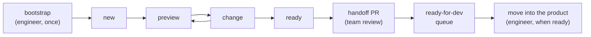

# Design Space

`design-space` is an Agent Skill that gives a React repository a design space: a second app, in
one folder, where designers and their agent build prototypes on fake data using the product's real
components and tokens. When a prototype is finished, it is handed off as a pull request that
follows the team's review workflow; once merged, an engineer moves it into the product when ready.

It serves two kinds of reader:

- **Engineers** adopt it once, with a bootstrap that scaffolds the folder, the guardrails and the
  checks, and then review what designers hand off.
- **Designers** work in the folder with their agent, from a description or a sketch to a prototype
  that is ready for development, without touching the product.

The skill works only with a design space it bootstrapped. Publishing previews for people who do not
run the project is not available yet; the skill refuses to publish and says so.

## Four pillars

Bootstrap sets up four pillars in its single PR, so a designer who opens the design space for the
first time finds a working catalog of the product's design system, not an empty folder.

| Pillar | What the designer finds on day one |
| --- | --- |
| Tokens | Every product token, mapped and grouped by kind (colors, spacing, type, radius, shadow, ...) |
| Components | A page per component with its specimens and a Playground |
| Prototypes | An empty prototype table, ready for `new` |
| Audits | Five audit pages, including a first color-vision (color blindness) test |

Tokens come from wherever the project keeps them (CSS variables, Tailwind v3 or v4, a theme
object), normalised into one map; a token that cannot be classified shows as kind `other` and is
never dropped. Components are the design system folder given to bootstrap with `--components`,
not every React component in the app. A component that cannot render without app context is
listed as Excluded with a written reason instead of getting a fake specimen. A light/dark switch
in the top bar changes the theme for the token page, the specimens and the audits.

The five audits are report-only pages: color vision, contrast (WCAG 2.1), token usage, component
coverage and accessibility (axe-core). They never block CI, `ready` or a PR. The structural checks
(scope, meta, import boundaries, smoke) stay blocking. Audit settings are engineer-owned, so a
designer cannot silence an audit. See [references/audits.md](references/audits.md).

## The shell

The design space is a small app with a sidebar: Tokens (one page per kind: colors by role,
typography, spacing, radius, shadow, other), Components (one page per specimen), Shared
components (made in `library/`), Prototypes and Audits, with a filter box and a light/dark
switch. The home page counts what exists. It is styled by twelve `--ds-*` variables that
bootstrap maps to the product's own tokens (neutral defaults for the rest), so it looks like the
product, while specimens render unstyled by it. A component page shows its specimens and, when
the specimen exports a `playground`, a Playground: controls for its props, the live component
and the JSX for the current props, ready to copy. See
[references/components.md](references/components.md).

## Flow



## Stages and commands

| Stage | Who acts | Skill or command | What comes out |
| --- | --- | --- | --- |
| Adopt the skill | Engineer | `design-space` bootstrap | A scaffold PR with the folder, the four pillars, guard, checks, scope workflow and a profile |
| Start a prototype | Designer | `new` | A `proto/<name>` branch and a flow folder from a description or sketch |
| See it locally | Designer | `preview` | A local server and a link, with states to try |
| Iterate, with Agentation notes | Designer | `change` | Updated flow, from a request or pending visual notes |
| Declare it finished | Designer | `ready` | `ready-for-dev` status, a commit, a push and a handoff PR |
| Merge the handoff PR | Designer, after the team's review | GitHub merge, once the scope check passes and the repository's review rules are met | The flow on the main branch as `ready-for-dev`, waiting for engineering |
| Move into the product | Engineer, when ready | `git mv`, outside this skill; `tribunal:review-pr`, `pr-evidence` where the repository uses them | The flow in product code, with the real API |
| Release | Engineer | `release-notes` where the repository uses it | Release notes that embed the evidence |

`tribunal:review-pr`, `pr-evidence` and `release-notes` are optional. The skill does not depend on
them; use them where your repository already does. `help` is also available at any point to explain
the steps and diagnose setup. The step contract is in [references/flows.md](references/flows.md) and
the bootstrap steps are in [references/bootstrap.md](references/bootstrap.md).

## Harness support

The designer tooling works on any harness. What differs is how strongly the product is protected.

| Level | Harnesses | What protects the product |
| --- | --- | --- |
| Enforced | `claude-code` (once started in the design space folder; until then Advisory) | A guard blocks the call, plus CI and review |
| Enforced | `codex` (once the project is trusted, the hook is approved in `/hooks`, and Codex is started in the folder; until then Advisory) | A guard blocks the call, plus CI and review |
| Advisory | `opencode`, `cursor`, `copilot` and any other harness | Written rules, generated scripts, CI and review |

Enforced is conditional, and bootstrap states the level for each harness you choose. CI and
code-owner review are the backstop on every harness, so no harness is protected unconditionally. See
[references/harnesses.md](references/harnesses.md) for the activation conditions, limits and how to
add a harness.

## Install

```bash
npx skills add xmartlabs/agent-skills --skill design-space
```

## Configure a repository

There is nothing to write by hand. Ask your agent to adopt the skill; bootstrap scaffolds the
design space and writes `.design-space.json` at the repository root:

```json
{
  "schemaVersion": 1,
  "layout": "app",
  "start": {
    "command": "npm run design-space:dev",
    "url": "http://127.0.0.1:4100/"
  },
  "paths": {
    "roots": ["design-space"]
  }
}
```

An engineer may then add optional fields, such as `baseBranch` or `paths.tokenSource`, and
validate the profile. Bootstrap also takes `--components <path>`, which sets `paths.components`:

```bash
node /path/to/design-space/scripts/validate-profile.mjs .design-space.json
```

See [references/profile.md](references/profile.md) for the full contract.

## Privacy

This repository is public. Profiles remain in their consuming repositories. Do not contribute a
consumer profile, private project name, private path, domain, identifier, or copied application
code here. Public examples and tests must use neutral placeholders.
